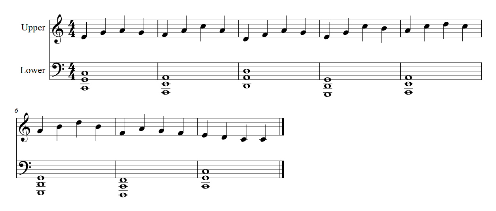
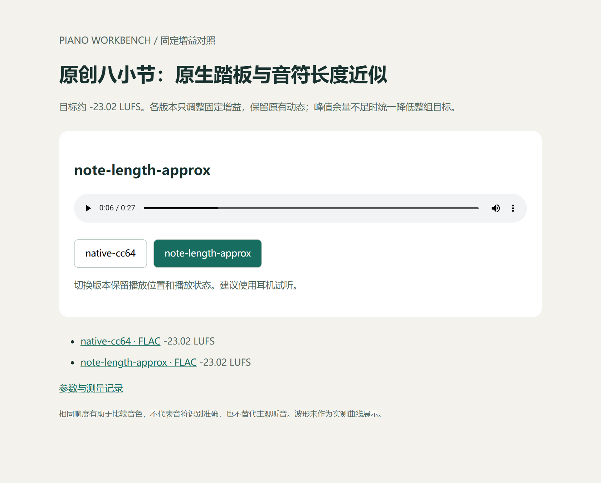
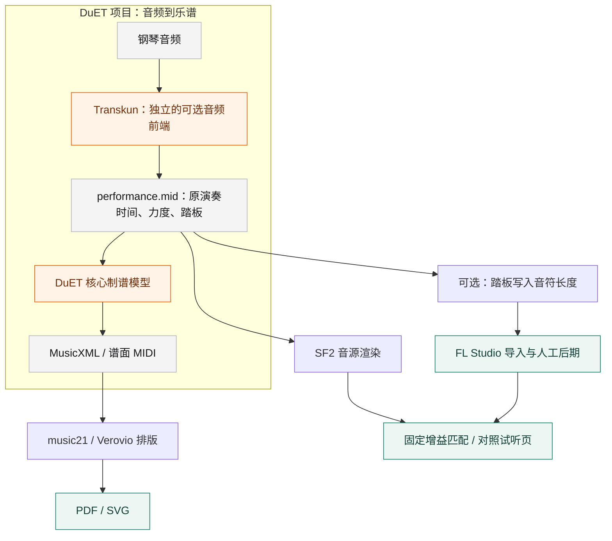

# Piano Workbench

**把钢琴录音整理成可编辑乐谱，并用保留演奏细节的 MIDI 制作可公平比较的试听。**

DuET 配套工作流，面向 Windows 本地运行。把音频转谱、乐谱排版、SF2 音源渲染、DAW 踏板兼容和同响度试听组织在一起。核心工具也可独立使用，无需先安装模型。

`v0.1.0` · `Python 3.11+` · Windows / Ubuntu 24.04 · [MIT](LICENSE) · [CI 状态](https://github.com/Puiching-Memory/piano-workbench/actions/workflows/tests.yml)

[看实际效果](#实际效果) · [看工作流程](#工作流程) · [安装](#安装) · [快速试用](#5-分钟试用不下载模型) · [FL Studio 教程](docs/fl-studio.md) · [验证记录](docs/verification.md)

## 可以做什么

| 你的起点 | Workbench 帮你完成 | 得到什么 |
| --- | --- | --- |
| 一段钢琴录音 | 调用 DuET 项目完成识别与制谱，再排版 | 原演奏 MIDI、MusicXML、PDF / SVG |
| 一份演奏 MIDI | 保留时间、力度和踏板，用自己选择的 SF2 渲染 | WAV 与渲染参数记录 |
| 两个音源或混音版本 | 测量响度，以固定增益匹配，生成可切换版本的试听页 | FLAC / MP3、HTML、响度报告 |
| 想在 FL Studio 继续制作 | 生成踏板兼容 MIDI，按教程手动调整音色、EQ 和混响 | 可继续编辑的人工后期流程 |

## 实际效果

下面使用项目原创的**八小节、56 音符**合成测试曲。它可重复生成，未使用用户歌曲，也不是音频识别准确率案例。

### 乐谱：可下载，也可继续编辑

[](examples/score/score.pdf)

从仓库内 MusicXML 实际排版的谱面局部。点击图片查看完整 PDF；[下载 MusicXML](examples/score/score.engraved.musicxml) 可在支持的制谱软件中继续编辑。[原演奏 MIDI 与生成说明](examples/original-eight-bars/)

### 试听：同一演奏，在同一位置切换版本

[](examples/listening/index.html)

真实页面截图。下载仓库后打开 [examples/listening/index.html](examples/listening/index.html)，即可试听并切换版本；GitHub 文件页只显示 HTML 源码，不运行播放器。也可以直接下载下方音频。

| 版本 | MP3 试听文件 | 无损 FLAC | 实测响度 | 实测真峰值 |
| --- | --- | --- | --- | --- |
| 原生 CC64 踏板 | [native-cc64.mp3](examples/listening/native-cc64.mp3) | [FLAC](examples/listening/native-cc64.flac) | −23.02 LUFS | −6.21 dBTP |
| 音符长度近似 | [note-length-approx.mp3](examples/listening/note-length-approx.mp3) | [FLAC](examples/listening/note-length-approx.flac) | −23.02 LUFS | −6.51 dBTP |

两版来自**同一 Salamander 钢琴音源**，演示原生踏板和 DAW 导入兼容近似的差别；只调整固定增益，不额外压缩或限幅。此处未展示 FL Studio 混音前后对比。数值见 [测量记录](examples/listening/comparison.json)，音源及录音署名见 [ATTRIBUTION](examples/listening/ATTRIBUTION.md)。

## 工作流程

**一次转谱，两条输出路线：乐谱用于阅读与编辑，原演奏 MIDI 用于音源试听和后期制作。**



### 项目边界

- **DuET 项目**调用独立的 Transkun 模型处理音频，然后由 **DuET 核心模型**整理乐谱。这里调用上游，未重写或训练模型。
- **试听使用 `performance.mid`**。`score.mid` 的谱面节奏和播放速度可能不同，不应拿它代替原演奏来判断音色。
- **PDF 排版与后期制作**是配套工具。FL Studio 部分提供导入教程和参数模板，当前 CLI 不控制 DAW，也不提供通用 GUI 自动混音。
- 合成示例、文件检查和响度匹配不等于识别准确率评估或人的听音验收。

## 安装

需要 Python 3.11+。音频对照需要 `ffmpeg` 和 `ffprobe` 在 PATH 中。

```powershell
python -m venv .venv
.\.venv\Scripts\Activate.ps1
python -m pip install -e .
piano-workbench doctor
```

基础依赖为 NumPy、mido、TinySoundFont 的 Python 封装。不会自动下载模型或音源；用户自行选择 SF2，并保留其来源和许可。

Ubuntu / Debian 安装前需准备系统依赖。`tinysoundfont` 的依赖包含 PyAudio，在 Linux 上编译时需要 PortAudio 头文件；离线渲染也会安装这项依赖：

```bash
sudo apt-get update
sudo apt-get install -y portaudio19-dev ffmpeg
python3 -m venv .venv
source .venv/bin/activate
python -m pip install -e .
```

如需音频转谱，先按硬件安装兼容的 PyTorch，再安装上游可选组件：

```powershell
python -m pip install -e ".[transcription]"
```

DuET 代码依赖固定到已验证的提交；模型首次使用时由上游下载。可用 `--model` 指向本地权重目录，或用 `--model-revision` 指定 Hugging Face 模型版本。PyTorch/CUDA/torchaudio 的组合请先阅读 [Windows 环境说明](docs/windows.md)。

PDF 排版为另一个可选组件：

```powershell
python -m pip install -e ".[score]"
```

## 5 分钟试用：不下载模型

生成项目原创的八小节演奏和 MusicXML。此数据是合成测试曲，**不是模型预测**：

```powershell
piano-workbench demo --output runs/demo-input
piano-workbench inspect runs/demo-input/performance.mid
```

使用自己提供的 SF2 渲染，例如 [FreePats Salamander Grand](https://freepats.zenvoid.org/Piano/acoustic-grand-piano.html)：

```powershell
piano-workbench render runs/demo-input/performance.mid --sf2 "C:/SoundFonts/SalamanderGrandPiano.sf2" --preset 0 --output runs/grand.wav
```

SF2 的 bank/preset 使用 **从 0 开始的索引**。不同文件的钢琴预设不一定都在 0；选错会得到其他乐器。显式选择的预设会覆盖 MIDI 内的 program change，其他受支持的控制器照常转发。

## 用自己的录音完成整条流程

```powershell
piano-workbench run "C:/Music/piano.mp3" --model Wayne42/DuET --device cuda --sf2 "C:/SoundFonts/SalamanderGrandPiano.sf2" --engrave --output runs/my-piece
```

`--engrave` 需要 `[score]`，音频识别需要 `[transcription]`。CPU 可用 `--device cpu`。输出目录必须是新的；不会覆盖之前的结果。

```text
my-piece/
  transcription/                   # 上游 DuET 输出及原演奏 MIDI
  engraving/                       # 可选 PDF、SVG、排版 XML 和事件核验
  performance_pedal_baked.mid       # 可选 DAW 路线用；SF2 不使用它
  performance_pedal_baked.pedal.json
  renders/                         # 原演奏 MIDI 的 WAV / 渲染记录
  listening/                       # FLAC、MP3、index.html、响度记录
  workflow.json
```

只持有演奏 MIDI 时可跳过模型：

```powershell
piano-workbench run performance.mid --skip-score --sf2 piano.sf2 --output runs/midi-audition
```

`run` 可重复指定 `--sf2`，共享 `--bank` 和 `--preset`。若不同音源需要不同预设，分别 `render`，再 `compare`。

## 同响度比较音源或 FL 导出

```powershell
piano-workbench compare --audio "before=C:/Exports/before.wav" --audio "after=C:/Exports/after.wav" --title "钢琴混音前后" --output runs/comparison
```

打开 `runs/comparison/index.html`。按钮切换版本时保留播放位置和播放状态。浏览器不支持本地 FLAC 时可用默认生成的 MP3；也可在该目录运行 `python -m http.server 8000` 后访问本地页面。

- 默认匹配到约 **−23 LUFS**，仅使用一个固定增益，不压缩、不限幅。
- 如某版的峰值余量不足，会**统一降低整组目标响度**，而不是压平该版的强音。
- 原文件不修改；测量、增益、校验值写入 `comparison.json`。无损 FLAC 是验证基准，MP3 为试听副本。
- 对照前自行确认是同一演奏和相同段落；程序不能仅靠音频判断它们是否是同一演奏。

## FL Studio 可选路线

```powershell
piano-workbench bake-pedal performance.mid --output runs/performance-for-daw.mid
```

这是为不消费 CC64 的导入路径准备的**音符长度近似**，不代表完整踏板共鸣或半踏板。原 MIDI 保持不变；同音重奏时裁掉前音的重叠，以避免含混的 note-off。tempo、音高、起点、力度、通道及非 CC64 的其他消息保留。

原生支持 CC64 的 SF2 渲染应直接使用原 MIDI，不应再次烘焙踏板。

见 [FL Studio 导入与混音教程](docs/fl-studio.md) 和 [暖钢琴参数模板](presets/fl-studio-warm-piano.json)。模板是可读的参数清单，**不是 FL 插件可直接加载的预设或 FLP**。

## 排版与核验

```powershell
piano-workbench engrave runs/my-piece/transcription/score.musicxml --output runs/my-engraving
```

保存新的 XML，不修改原文件。排版可能重组显示声部，但会核对音高、起点、时值和谱表归属。若改变了这些事件，停止并保留未完成结果供排查。当前自动排版拒绝倚音输入；复杂表情、歌词及原版式不保证完整保留，可在 MuseScore 等编辑器打开原 XML 处理。

## 验证

```powershell
python -m unittest discover -s tests -v
```

测试覆盖跨 tempo 的时间、分通道踏板、同音重奏、未闭合 MIDI、响度峰值策略、同响度输出和页面注入边界。另有需本地 SF2 的渲染集成验证。实际执行记录见 [验证说明](docs/verification.md)。

## 许可与上游

本项目代码和原创 MIDI/MusicXML 示例采用 [MIT](LICENSE)。第三方模型、音源和软件各自保留原许可；本项目许可不替代它们。

- [DuET](https://github.com/wei-zeng98/DuET)：代码 MIT；epoch83 模型权重 CC BY-NC 4.0。
- [Transkun](https://github.com/Yujia-Yan/Transkun)：DuET 的可选独立音频前端。
- [TinySoundFont](https://github.com/schellingb/TinySoundFont) 与 [tinysoundfont](https://pypi.org/project/tinysoundfont/)：SF2 渲染。
- [music21](https://www.music21.org/) / [Verovio](https://www.verovio.org/)：可选乐谱处理与排版。

详见 [第三方说明](THIRD_PARTY_NOTICES.md)。仓库不附带第三方模型权重、SF2、FL Studio、商业歌曲或从商业歌曲识别的乐谱/MIDI。公开示例来源另行标注。

README 封面为 AI 生成的概念插画；乐谱和播放器图片为实际产物截图。图片来源与生成提示词见 [素材说明](docs/assets/README.md)。
